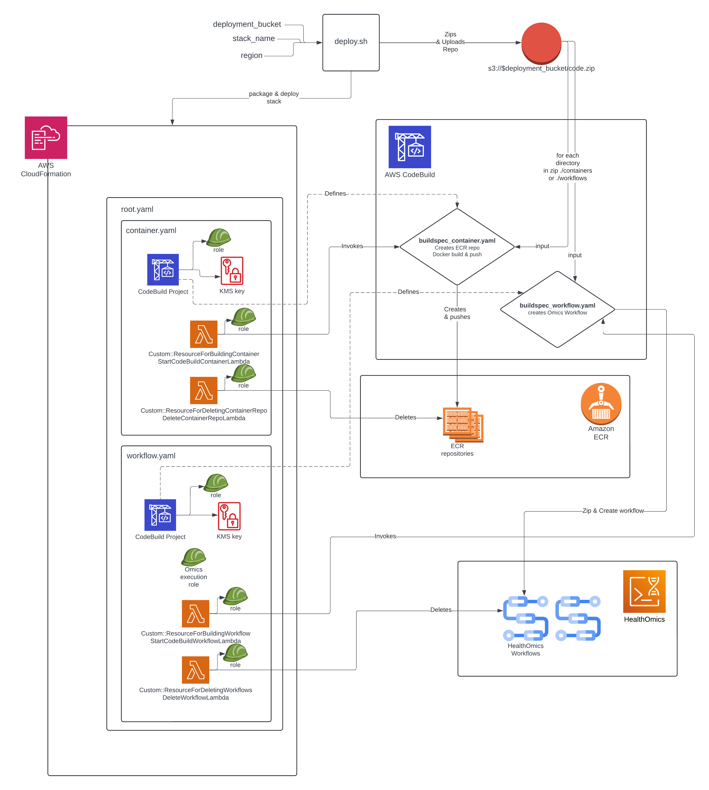

# Drug Discovery Workflows for AWS HealthOmics

## Description

A collection of AWS HealthOmics workflow examples to accelerate drug discovery.

## Workflow Catalog

### Modules

- [Alphafold2-Monomer](https://github.com/aws-samples/drug-discovery-workflows/tree/main/assets/workflows/alphafold2-monomer): From Google DeepMind. Predict the 3D structure of one or more single-chain proteins
- [Alphafold2-Multimer](https://github.com/aws-samples/drug-discovery-workflows/tree/main/assets/workflows/alphafold2-multimer): From Google DeepMind. Predict the 3D structure of multi-chain protein complexes.
- [AMPLIFY Pseudo Perplexity](https://github.com/chandar-lab/AMPLIFY): From Amgen and Mila. Calculate the pseudoperplexity of an amino acid sequence using a protein language model.
- [Boltz-2](https://github.com/jwohlwend/boltz): From MIT. Predict biomolecular structures containing combinations of proteins, RNA, DNA, and other molecules. Now supports MSA inference, including with paired alignments for protein complexes!
- [BoltzGen](https://github.com/HannesStark/boltzgen): From MIT. All-atom generative model for designing proteins and peptides across all modalities to bind a wide range of biomolecular targets.
- [Chai-1](https://github.com/chaidiscovery/chai-lab): From Chai Discovery. Predict the structure of biomolecule complexes including proteins, amino acids, and/or ligands.
- [Colabfold-Search](https://github.com/sokrypton/ColabFold): Iterative MSA search algorithm using MMseqs2.
- [ESMfold](https://github.com/aws-samples/drug-discovery-workflows/tree/main/assets/workflows/esmfold): From Meta. Rapidly predict protein structures using embeddings geneted by the ESM2 protein language model.
- [Generate Protein Sequence Embeddings](https://github.com/aws-samples/drug-discovery-workflows/tree/main/assets/workflows/generate-protein-seq-embeddings):  From Meta. Generate ESM-2 vector embeddings for one or more protein amino acid sequences.
- [TemStaPro](https://github.com/ievapudz/TemStaPro): From Institute of Biotechnology, Life Sciences Center, Vilnius University. Predict protein thermostability using sequence representations from a protein language model.

## Deployment

This repository contains Amazon CloudFormation templates and supporting resources to automatically deploy AWS HealthOmics private workflows into your AWS account. You are responsible for all costs associated with the deployed resources.

### Quick Start

1. Clone this repository to your local environment.
2. Authenticate into your AWS account of interest and `cd` into the project dir.
3. Run the following command, replacing the placeholders with the name of a S3 bucket, desired stack name, and region:

```bash
bash scripts/deploy.sh \
  -b "my-deployment-bucket" \
  -n "my-aho-ddw-stack" \
  -r "us-east-1"
```

The CloudFormation deployment and asset build steps should finish in about 15 minutes. Once the deployment has finished, you can create a private workflow run using the Amazon HealthOmics console, CLI, or SDK.

Once the deployment has finished, you can create a private workflow run using the Amazon HealthOmics console, CLI, or SDK. You may re-run the `./deploy.sh` script with the same arguments to update the CloudFormation stacks after code modifications to NextFlow scripts, Dockerfiles, or container build context directories are saved. This will trigger a rebuild and push of containers to ECR with the `latest` tag, and create new versions of the HealthOmics workflows.

To add a new module add the necessary files to the `assets` folder. There are three main components:

Many of the workflows in this repository require additional model weights or reference data. Please refer to the README files for each workflow in the `workflows/` folder.

## Third Party Credentials

Follow these steps to download data from third-party repositories:

1. Obtain an API key or other credential with the necessary access to the data.
2. Save the credentials in AWS Secrets Manager, for example:

```bash
aws secretsmanager create-secret \
    --name MyDataCredentials \
    --description "My data credentials." \
    --secret-string "{\"API_KEY\":\"MyFakeKey\",\"ORG\":\"myfakeorg\"}"
```

1. Add your data uri to a new file in the `assets/data` folder.
2. Run the deploy.sh script with the `-s` option and pass in your secret name (not the key or value) from step 1. CodeBuild will save these secret values as environment variables in the data download job.

### Infrastructure Diagram



## Development

To add a new module, fork the repository. There are three main components:

- **Containers:** contains the required information/data to build Docker images for specific tasks
- **Data:** contains links to parameters and other reference data used by workflow models
- **Workflows:** Specifc workflows, such as AlphaFold-Multimer that contain the `main.nf` script.

```txt
assets/
└──containers/
    ├── alphafold
    ├── biolambda
    └── ...
    data/
    ├── esm2.txt
    ├── esmfold.txt
    ├── rfdiffusion.txt
    └── ...
    workflows/
    ├── alphafold2/
    ├── alphafold-multimer/
    └── ...
```

The `containers` folder contains Dockerfiles and supporting files to build docker containers. The deployment process will attempt to use every subfolder here as a Docker build context without any further configuration. Right now, there are two types of containers provided by default.

The `data` folder contains `.txt` files that specify uris to download during stack creation. The deployment workflow will save the contents of each file in the following S3 locations:

### Linting

You can lint this repositories NextFlow code using the AWS provided tool [awslabs/linter-rules-for-nextflow](https://github.com/awslabs/linter-rules-for-nextflow), which has been been integrated with `make`:

```bash
make lint
```
